# CrewPoint design system

CrewPoint's look is **Slate and sage with Lucide icons**, chosen in Round 1 (Spec #186, ledger L22). The approved mockups are in [`mockups/`](mockups/README.md). Every mocked-up screen is now built, so **the code is the source of truth**; the mockups stay as the record of the agreed direction and are not updated (Req 19).

Everything that sets the look lives in `lib/app/core/design/`. Screens take colours, type, spacing and visual widgets from it and never set their own. `test/design/design_guard_test.dart` enforces this (see [The guard](#the-guard)).

The pictures below are the Design gallery's golden images. They are made on Linux by CI. To see the gallery in the app, open **Profile → Dev Tools → Design gallery** in the dev build. It shows every component in light, dark and 200% text.

## Tokens

Read tokens through the theme with `context.cp`:

```dart
final cp = context.cp;
Text('Up next', style: cp.type.titleLarge.copyWith(color: cp.colors.text));
Padding(padding: EdgeInsets.all(cp.space.lg), child: ...);
```

| Token | Read with | What it holds |
|---|---|---|
| Colours | `cp.colors` | `background`, `surface`, `fill`, `border`, `text`, `textMuted`, `accent`, `accentSoft`, `onAccent`, `banner`, `onBanner`, and the status pairs `done`/`doneSoft`, `due`/`dueSoft`, `overdue`/`overdueSoft`. Light and dark differ only in these values. |
| Type | `cp.type` | Material's roles (`headlineLarge` is the page title, `titleLarge` a section, `titleSmall` a row title, `bodyMedium` body text, `bodySmall` a subtitle, `labelMedium` a chip) plus `stat` and `number` with tabular figures. Inter for text and Inter Display for headings, both bundled. |
| Spacing | `cp.space` | `xs` 4, `sm` 8, `md` 12, `lg` 16, `xl` 24, `xxl` 32, `xxxl` 48. |
| Corners | `cp.radii` | `xs` 4, `sm` 8 (fields, icon tiles), `md` 12 (cards, buttons), `lg` 16 (banners, sheets), `xl` 24, `pill`. |
| Sizes | `cp.sizes` | Icon sizes, avatar sizes, `tapMin` 48, and component sizes. |
| Motion | `cp.motion` | `fast` 150 ms, `medium` 250 ms, `slow` 350 ms, and `curve`. Keep motion short and subtle. |
| Shadows | `cp.shadows` | `card`, the faintest lift (none in dark mode), and `raised` for menus and sheets. |
| Icons | `CpIcons.x` | Every glyph by its role, all Lucide. Constants, so `const Icon(CpIcons.actionAdd)` works. |
| Fixed colours | `CpFixedColors.x` | The few colours that must not follow the theme, such as a QR code's ink and paper, which stay dark on light so the code scans. |

The raw values sit in two files, so each change happens in one place:

- `tokens/palette.dart` holds every colour, as ARGB integers, so the PDF theme reads the same values without Flutter.
- `tokens/scale.dart` holds every number.

Exported PDFs (the budget and task reports) take their colours and print sizes from `pdf/cp_pdf_theme.dart` (`CpPdfTheme.text`, `.accent`, `.pageMargin`, `.titleSize` and so on). It reads the light palette, since reports are printed on white, and stays free of Flutter so the builders remain pure Dart.

`CpTheme.light()` and `CpTheme.dark()` build `ThemeData` from the tokens alone. A screen that still uses plain Material widgets therefore gets the same colours and fonts.

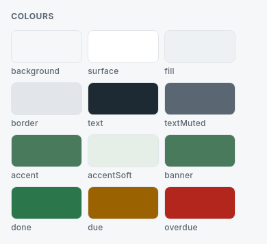 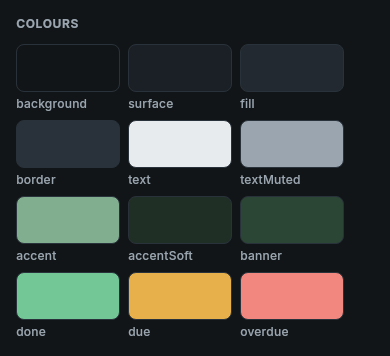

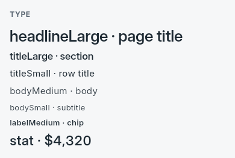

### Colour rules

- **One accent.** Sage marks what can be tapped or is selected: primary buttons, links, the selected tab, selected rows and choices.
- **Status colours mean status.** Green means done or paid, amber means due, and red means overdue, an error or a destructive action. They always sit beside an icon and are never used for decoration. To label something that isn't a status, use a `CpTag`.
- **Contrast.** Body text, chip text and button text clear WCAG AA (4.5:1) in both modes. `test/design/cp_theme_test.dart` checks this. The light Done green is a shade darker than the mockup's for this reason.
- No gradients, illustrations or cream background.

## Components

All components are in `lib/app/core/design/components/` (import `components.dart`). They are plain widgets with no Riverpod, Firebase or feature code, and they take every string from their caller, so screens pass `context.strings`. Interactive parts take a `Key` from the caller, named `domain.feature.action`.

### Card and list row

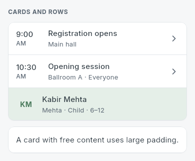

- **`CpCard`** is the container for rows, stats and form sections. Its default padding is none, so rows run edge to edge. For free content, pass `EdgeInsets.all(cp.space.lg)`. With `onTap`, the whole card becomes one button; give it a `semanticLabel`.
- **`CpListRow`** has an optional leading widget (avatar, icon tile or time), a title, an optional subtitle and an optional trailing widget. With `onTap`, it reads as one button and shows a chevron. `selected` marks the chosen row in a list and detail layout.
- **`CpRowGroup`** places rows inside one card with hairline dividers between them.

### Status chip, tag and section header

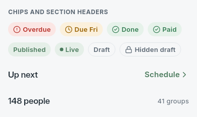

- **`CpStatusChip`** is for done, due or overdue only. It always shows an icon and a colour, so status never relies on colour alone.
- **`CpTag`** is any other label. The `accent` tone is for a state worth noticing, such as Published or Live (with `dot: true` for "now"). The `quiet` tone is for a small fact, such as Draft or Child.
- **`CpSectionHeader`** is a section title marked as a heading. It can have a quiet count on the right (`trailingText`) or a link (`actionLabel`, `onAction`, `actionKey`).

### Stat card, stat grid and progress ring

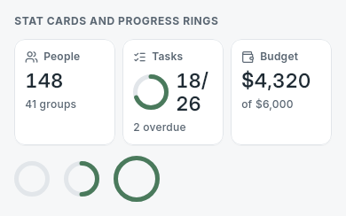 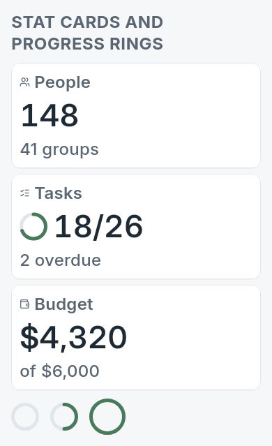

- **`CpStatCard`** shows an icon and label, a large value and an optional caption. With `progress` (0 to 1) and `progressLabel`, the value sits beside a ring. Screen readers hear the label, value and caption as one.
- **`CpStatGrid`** puts stat cards side by side, as many to a row as fit: three on a phone at normal text, one at 200%. Always lay stat cards out with it.
- **`CpProgressRing`** is a single accent arc. It needs a `semanticLabel`, such as "18 of 26 done".

### Avatar and avatar stack

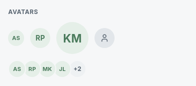

- **`CpAvatar`** shows initials in an accent tint, in small (32), medium (40) or large (64). Someone with no name shows a person icon; pass a `semanticLabel` such as "Unnamed person". Screen readers hear the name, not the initials.
- **`CpAvatarStack`** shows the first few avatars overlapping, plus a "+N" for the rest. It reads as its `semanticLabel`, such as "148 attending".

### Empty, loading and error states

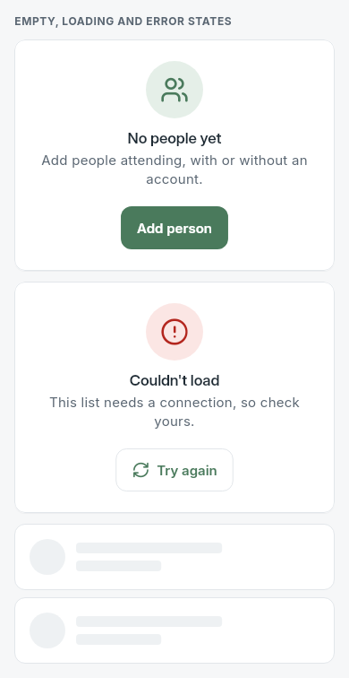

- **`CpEmptyState`** has an icon, a title, a short hint and an optional action. Say what will appear and how to add it.
- **`CpLoadingState`** is a spinner with an optional label. Use `CpLoadingState.rows` when a list is about to appear. Either way, screen readers hear one `semanticLabel`.
- **`CpErrorState`** shows what failed, what to do, and a retry button. It is a live region, so screen readers announce it. Say what the person can do, such as "This list needs a connection, so check yours."

### Top bar

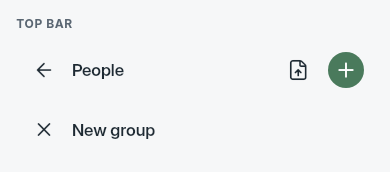

**`CpTopBar`** goes in `Scaffold.appBar`. It has back (or `CpIcons.actionClose` for a full-screen form) on the left, a title marked as a heading, and up to three `CpTopBarAction`s. Each action has a tooltip, which is also its screen reader label, and is at least 48 px. Mark the screen's main action `primary` to draw it as an accent circle; use one primary action per bar at most.

### Event cover

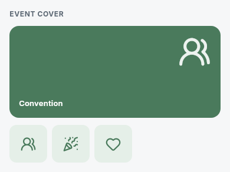

- **`CpCoverBanner`** shows an event's cover photo, cropped to fill, or without one a calm banner in the `banner` colour with the event's icon and an optional label (Spec #186 Req 44). It never shows stock or per-template photos.
- **`CpCoverThumb`** is the same as a small square on a list card: the photo, or the icon on the accent tint.

Screens use the app wrappers `EventCoverBanner` and `EventCoverThumb`, which read the photo and pick the icon.

### Buttons

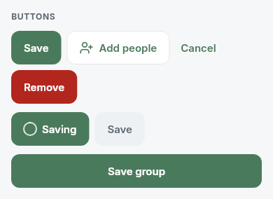

**`CpButton`** comes in four variants:

- `CpButton(...)` (primary): the screen's main action. Use one per screen or sheet.
- `CpButton.secondary`: another action beside it.
- `CpButton.text`: a quiet action, such as Cancel.
- `CpButton.destructive`: removes or ends something. Ask for confirmation first, in a `CpDialog`.

Set `busy: true` while the action runs. The button shows a spinner, ignores taps and reads as unavailable, so a save never runs twice. A button with `onPressed: null` is disabled. `expand: true` fills the width. `icon` puts a glyph before the label; `leading` puts any small picture there instead, such as the Google or Apple logo on sign-in.

**`CpSaveBar`** is a form's Save at the bottom of the screen, in `Scaffold.bottomNavigationBar`: the surface colour, a top border, and its button at the end, only as tall as the button.

### Fields

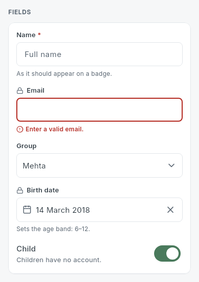

Every field has a label above it (with a red star when `required`; pass `requiredLabel` so screen readers say "required"), then the input, then `help`, or the `error` in its place with an icon. `labelIcon: CpIcons.lock` marks a private field.

- **`CpTextField`** is a text input. It works alone (pass `error`) or in a `Form` (pass `validator`). Put the test key on the input with `fieldKey`.
- **`CpSelectField`** shows a chosen value and runs `onTap`, where the caller opens its own picker sheet (such as the group picker). `placeholder` is shown, muted, when nothing is chosen. With `onClear` and `clearLabel`, a chosen value can be cleared. `fieldKey` (on this and `CpDateField`) puts a test key on the tappable field itself.
- **`CpDateField`** opens the platform's own picker: a wheel on iOS, the calendar dialog elsewhere (Req 21). Dates show through the caller's `format`. With `clearLabel`, a chosen date can be cleared.
- **`CpSwitchRow`** is a title, optional help and the platform's switch. The whole row toggles, and it reads as one switch.
- **`CpField`** gives any custom input the same label, help and error frame.

**Text controllers.** The State that creates a `TextEditingController` disposes it in its own `dispose()`. Never dispose one when a dialog or sheet returns: the route still rebuilds while it closes, for example as the keyboard goes down, and that crashed the app in #185.

### Choice chips and segmented choices

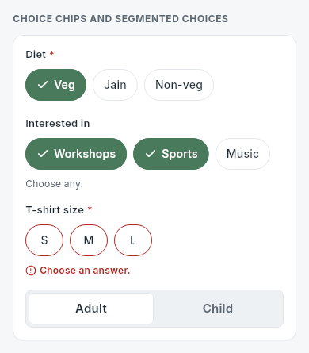

- **`CpChoiceChips`** shows answers as tappable chips that wrap onto more lines (ledger L5).
  - Single choice by default; `multiple: true` for "choose any".
  - Tapping the chosen single answer clears it unless the question is `required`.
  - Each chip reads its label and whether it is selected.
- **`CpSegmented`** is two to four short exclusive options side by side, such as Adult or Child, or Yes or No. Use chips when there are more options or the labels are long.

Both give a light selection tick on iOS and the platform's tap feedback on Android (Req 21).

### Search and filters

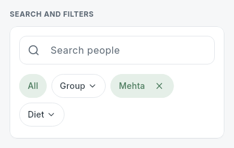

- **`CpSearchField`** is the search box at the top of a list, such as "Search people". Its hint is also its label for screen readers. The caller owns the controller; `fieldKey` puts the test key on the input.
- **`CpFilterChip`** is one filter above a list. Off, it is an outlined pill that opens a choice (`menu: true` adds the ⌄). On, it is filled and shows what was chosen, with a × to clear it when `onClear` is given.

### Sheets and dialogs

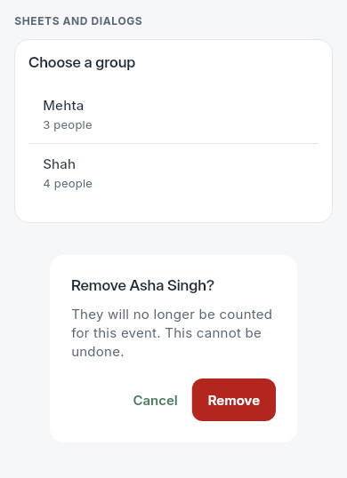

- **`showCpSheet`** opens a bottom sheet with a drag handle, an optional `title` (read as a heading), and content that scrolls and stays above the keyboard. Use it for pickers and short forms. Anything in it with a text controller owns that controller in its own State.
- **`CpDialog`** has a title, a message or content, and its buttons. Show it with `showDialog`. Put Cancel first as `CpButton.text`, then the main action. Make the main action destructive for removals.
- **`showCpTextPrompt`** asks for one line of text, such as a group name, and returns it trimmed, or null. It owns its controller, so it is safe as the keyboard closes.

## Layout

Layout lives in `lib/app/core/design/layout/` (Spec #186 Req 21–24). The same app serves phones, tablets and laptops; there is no separate admin site.

- **`CpShell`** frames the signed-in app.
  - **Under 840 px:** one column with the bottom bar. From 600 to 839 px the column stays phone width and is centred.
  - **From 840 px:** a left sidebar with the logo replaces the bar.
  - **Keys:** each destination is keyed `shell.bar.{id}` or `shell.rail.{id}`, and its count badge `….badge`.
  - **Resizing:** the body keeps its place in the tree, so routes, state and scroll positions survive a resize.
- **`CpListDetail`** shows a list and the chosen item, used for People, Tasks and Budget.
  - **From 840 px:** the item opens in a panel beside the list. With nothing chosen, the panel shows a quiet prompt, such as `context.strings.nav.selectToSee(words.one('participant'))`.
  - **Below 840 px:** the item is a full page.
- **The route is the source of truth for the list and detail.**
  - The detail route (such as `people/:participantId`) builds the same screen with that row chosen, so back and shared links work.
  - Build those pages with `cpListDetailPage`. Wide, rows change without a transition and the list keeps its scroll position. Narrow, the detail slides in as its own page, and resizing moves between the two.
  - Rows choose through `CpListDetail.select(rowContext, () => context.go(...))`, using a context inside the layout.
  - A detail with unsaved edits wraps itself in `CpUnsavedChanges(dirty: …)`, so switching rows asks first.

## Screen patterns

These come from the built screens; follow them for anything new.

- **A tab or page:** `Scaffold(backgroundColor: cp.colors.background, appBar: CpTopBar(...))`, then a `ListView` padded `lg` at the sides, `sm` on top and `xxl` at the bottom, holding a `ContentMaxWidth(maxWidth: cp.sizes.phoneColumn)` column with `lg` between sections. Sections are a `CpSectionHeader` and a `CpCard`.
- **Forms (the Person form):** fields grouped in padded cards under section headers, the main action in a `CpSaveBar`, and destructive actions as a `CpButton.text` or `CpButton.destructive` at the end of the form. Errors show beside the field, and a save that failed shows a `CpFieldError` above the cards.
- **Choosing one of a list:** a `CpSelectField` that opens `showCpSheet` with a card of `CpListRow`s, the chosen one `selected` with a `CpIcons.statusDone` tick and the others with `trailing: SizedBox.shrink()` to hide the chevron. Key each row `domain.feature.<field>.<id>`. Use this instead of a dropdown.
- **Admin screens:** `AdminScaffold`, `AdminList`, `AdminSaveBar` and `AdminNote` in `dashboard/presentation/roles/role_views.dart` wrap the patterns above, with `NoAccessView`, `LoadFailedView` and `GoneView` for the states.
- **Large text:** a row that puts text and a value side by side switches to stacking them when `constraints.maxWidth / textScale < 260`, so neither breaks mid-word.
- **App widgets built from the system:** `lib/app/core/widgets/` keeps only widgets that join the design system to app data, such as `ContentMaxWidth`, `MoneyText`, `LastUpdatedNote`, `EventTile`, `ConversationTile` and the route guards. They take every value from the tokens.

## 200% text

Every component lays out at 200% text without overflowing (the gallery's third variant):

- Rows and chips wrap.
- Stat grids drop to fewer columns.
- Avatars keep their initials at a fixed size, so the circle never overflows.

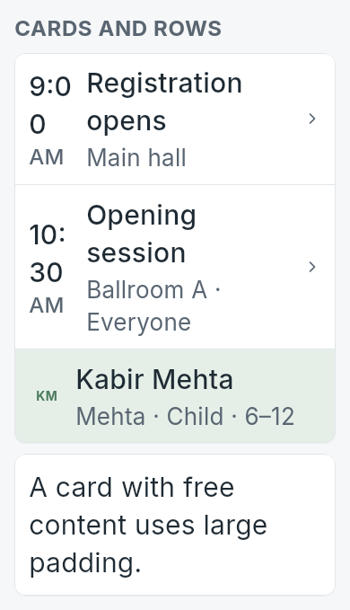

## The guard

`test/design/design_guard_test.dart` fails if code outside `lib/app/core/design/` uses any of these:

- a raw colour (`Color(0x…)`, `Colors.…`)
- `GoogleFonts` or `fontFamily:`
- a bare non-zero number in `EdgeInsets`, `SizedBox`, `BorderRadius` or `Radius`
- a plain Material `Card`, `ListTile`, chip, `ElevatedButton`, `FilledButton`, `OutlinedButton` or `TextButton`

Layout widgets and calculated sizes (`maxWidth * 0.5`) are allowed. Every file follows these rules. A file may break one for good only through `listedExceptions` in `test/design/design_guard.dart`, with its reason; the list is empty today.

The old `AppColors`, `AppSpacing`, `AppRadius`, `AppTypography`, `AppSizes`, `AppDurations` and `AppIcons` are gone (#208). `lib/app/core/constants/` holds only `app_assets.dart`, the asset paths.

## Golden tests

`test/design/golden/design_gallery_golden_test.dart` pictures every gallery section in light, dark and 200% text. The tests are tagged `design`:

- **Locally:** `dart_test.yaml` skips the `design` tag, because font rendering differs between macOS and Linux.
- **CI:** CI runs the goldens on every PR (`flutter test --tags design --run-skipped test/design/golden`) and uploads any differences as the `design-golden-failures` artifact.
- **Regenerating:** after an intended change, run `scripts/update-design-goldens.sh`. On Linux it regenerates the goldens directly. Elsewhere, it starts the **Design goldens** workflow, which regenerates them on Linux and commits them to your branch. Before that workflow is on `main`, push a commit whose message contains `[update-goldens]` instead.
- **Never commit goldens made on a Mac.**
